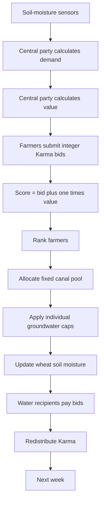

# Wheat Karma Water Allocation Simulation

This project models weekly irrigation allocation among wheat farmers using a
Karma-based mechanism.

The central party has soil-moisture sensors and calculates each farmer's water
demand and value. Farmers do **not** report their physical demand. They only
submit an integer Karma bid. Canal water is a finite shared resource, while
each farmer has an individual groundwater pumping capacity.

The model combines:

- Wheat evapotranspiration.
- Exponential soil-moisture loss when water is not added.
- Centralized sensor-based demand calculation.
- Fixed weekly canal supply.
- Individual weekly groundwater pumping capacities.
- Groundwater pumping cost tracking.
- Karma bids and score-based allocation.
- Integer pay-to-society Karma redistribution.
- Different wheat growth rates between farmers.

The implementation is in [`simulate.py`](./simulate.py).

## 1. Weekly Process

Each week follows this sequence:

1. Observe every farmer's soil moisture.
2. Calculate each farmer's wheat growth stage.
3. Calculate wheat evapotranspiration.
4. Calculate each farmer's physical water demand.
5. Calculate each farmer's value/urgency centrally.
6. Ask each farmer for an integer Karma bid.
7. Rank farmers using the bid and central value.
8. Allocate canal water to the highest-ranked farmers first.
9. Let each farmer pump up to their individual groundwater capacity to cover
   remaining demand.
10. Update soil moisture.
11. Charge bids to farmers who received water.
12. Redistribute the Karma pool.
13. Continue to the next week.



## 2. Units and Farmer State

For farmer `n` in week `t`:

- `theta_n(t)` is volumetric soil moisture.
- `theta_max` is the maximum target moisture.
- `theta_min` is the lower reference threshold.
- `Z_r` is root-zone depth in millimeters.
- `A_n` is farmer area in hectares.
- `l_n` is the gross irrigation depth required per unit area.
- `c_n` is the weekly deep-percolation coefficient.
- `k_n(t)` is the farmer's integer Karma balance.

Because demand includes farm area, water allocation is represented as an
area-weighted water amount (hectare-millimeter equivalent). The command-line
arguments retain the `_mm` name for readability, but values should be compared
consistently within the same simulation.

The current physical parameters are:

```text
Z_r       = 800 mm
theta_max = 0.25
theta_min = 0.10
beta      = 1.2
```

Farmers receive different randomly generated areas, application efficiencies,
growth rates, and initial soil-moisture levels. The random seed makes these
experiments repeatable.

The model uses application efficiency `e_n` to derive gross irrigation depth:

```text
l_n = Z_r / e_n
```

## 3. Wheat Soil-Moisture Model

### 3.1 Exponential moisture loss

The professor-confirmed assumption is that soil moisture decreases
exponentially when no water is added. The model applies this first:

```text
theta_after_percolation,n(t)
    = theta_n(t) * exp(-c_n)
```

Here, `c_n` is the weekly loss coefficient. Larger `c_n` means faster moisture
loss.

### 3.2 Wheat evapotranspiration

Wheat consumes water through crop evapotranspiration:

```text
ET_crop,n(t) = Kc_n(t) * ET0(t)
```

The reference evapotranspiration increases through the season:

```text
ET0(t) = 15 + 15 * t / T
```

where `T` is the number of simulated weeks.

The wheat crop coefficient uses four growth stages. Each farmer has a
growth-rate multiplier `g_n`, so farmers can be at different crop stages even
though they all begin the simulation at week zero:

```text
p_n(t) = clip(g_n * t / T, 0, 1)
```

The crop coefficient is:

```text
Kc_n(t) =
    0.3 + 1.6 * p_n(t)                         if p_n(t) <= 0.25
    1.15                                       if 0.25 < p_n(t) <= 0.625
    1.15 - 3.4 * (p_n(t) - 0.625)              if 0.625 < p_n(t) <= 0.875
    0.3                                        if p_n(t) > 0.875
```

This gives an initial growth stage, a development stage, a mid-season peak,
and a late-season/harvest stage.

### 3.3 Soil-moisture update

After percolation, the model subtracts crop consumption:

```text
theta_after_ET,n(t) =
    theta_after_percolation,n(t)
    - Kc_n(t) * ET0(t) / Z_r
```

Water received from the canal and groundwater is converted into effective
root-zone water using application efficiency and `beta`:

```text
effective_root_water_n(t) =
    received_water_n(t) * e_n / (beta * A_n)
```

Rain is modeled as a common depth for all farmers. The final transition is:

```text
theta_n(t+1) =
    clip(
        theta_after_ET,n(t)
        + [effective_root_water_n(t) + rain(t)] / Z_r,
        0,
        theta_max
    )
```

Clipping prevents negative soil moisture and prevents moisture from exceeding
the field-capacity threshold.

## 4. Centralized Demand Calculation

The planner calculates demand from sensor-measured soil-moisture deficit. A
drier farmer has higher demand.

The root-zone deficit depth is:

```text
deficit_n(t) = max(0, theta_max - theta_n(t))
```

The water-demand equation is:

```text
d_n(t) =
    beta * deficit_n(t) * A_n * l_n
```

In plain English:

- `theta_max - theta_n(t)` measures how much moisture the farmer is missing.
- `l_n` converts the moisture deficit into gross irrigation depth.
- `A_n` makes demand larger for larger farms.
- `e_n` determines `l_n`; lower efficiency means a larger gross demand.
- `beta` accounts for inefficiency or additional gross water required.

The farmer does not choose `d_n(t)`. The central party calculates it from the
sensors.

The central party also uses demand as the urgency value:

```text
value_n(t) = d_n(t)
```

This is a normalized groundwater-avoidance value: satisfying a larger demand
avoids more potential groundwater use.

## 5. Fixed Weekly Water Supplies

### 5.1 Canal supply

The canal provides a fixed amount every week:

```text
S_canal(t) = S_canal
```

The default is:

```text
S_canal = 300
```

This is deliberately limited relative to the combined farmer demand, so the
canal cannot satisfy everyone in a typical week.

### 5.2 Individual groundwater pumping

Groundwater is modeled as an individually pumped aquifer resource rather than
as one shared weekly bucket. Each farmer receives a weekly pumping capacity:

```text
G_cap,n ~ Uniform(40, 80)
```

After canal allocation, farmer `n` pumps:

```text
GW_n(t) =
    min(
        unmet_demand_n(t),
        G_cap,n
    )
```

One farmer's groundwater use does not reduce another farmer's pump capacity.
Farmers can still experience unmet demand when their individual capacity is
insufficient.

The groundwater cost is:

```text
Cost_n(t) = C_g * GW_n(t)
```

The current cost parameter is:

```text
C_g = 10
```

The simulation accumulates both groundwater volume and groundwater cost per
farmer. Groundwater cost is a primary efficiency metric because the Hassan
water-allocation model aims to reduce expensive groundwater pumping.

## 6. Karma Bidding and Ranking

Farmers bid only Karma. They do not bid demand or value.

The urgency weight is:

```text
urgency_n(t) =
    max(
        0,
        [theta_max - theta_n(t)] / [theta_max - theta_min]
    )
```

The current bidding policy is a simple heuristic:

```text
b_n(t) =
    min(
        k_n(t),
        floor(0.3 * urgency_n(t) * k_n(t))
    )
```

Therefore, bids are always whole-number Karma points and cannot exceed the
farmer's balance.

The central party ranks farmers using:

```text
score_n(t) =
    [b_n(t) + 1] * value_n(t)
```

The `+1` means a farmer with zero Karma can still have a positive score if
their centrally measured demand is positive.

## 7. Sequential Allocation

Farmers are sorted from highest score to lowest score.

### Canal allocation

The canal pool is allocated first:

```text
canal_n(t) =
    min(
        demand_n(t),
        remaining_canal_supply
    )
```

The process continues down the ranking until the canal pool is empty or all
demand has been covered.

### Groundwater pumping

After canal allocation, each farmer independently covers as much remaining
demand as their pump allows:

```text
remaining_demand_n(t) =
    max(0, demand_n(t) - canal_n(t))
```

Groundwater is allocated in the same score order:

```text
groundwater_n(t) =
    min(
        remaining_demand_n(t),
        groundwater_capacity_n
    )
```

The canal is still allocated in score order. Groundwater pumping then occurs
independently for every farmer, so a farmer's groundwater use does not consume
another farmer's groundwater capacity.

Total unmet demand is:

```text
unmet_n(t) =
    max(
        0,
        demand_n(t)
        - canal_n(t)
        - groundwater_n(t)
    )
```

## 8. Pay-to-Society Karma Settlement

A farmer who receives canal or groundwater pays their bid into society:

```text
payment_n(t) =
    b_n(t), if total received water_n(t) > 0
    0,      otherwise
```

The Karma pool is:

```text
P(t) = sum_n payment_n(t)
```

### Standard PBS redistribution

The collected pool is always redistributed equally among all farmers,
regardless of whether they received water:

```text
redistribution_recipients =
    {1, 2, ..., N}
```

This is the standard Pay-Bid-Sharing (PBS) rule. It keeps Karma as a conserved
currency rather than making it a direct compensation payment only for farmers
who lost access.

### Integer redistribution

Karma must remain an integer. If `P(t)` does not divide evenly among the
recipients:

```text
base_points, remainder = divmod(P(t), number_of_recipients)
```

Every recipient receives `base_points`. The remaining points are assigned
one at a time using a rotating order so that the same farmer is not always
favored.

The karma transition is:

```text
k_n(t+1) =
    k_n(t)
    - payment_n(t)
    + redistribution_n(t)
```

The implementation preserves:

```text
k_n(t) >= 0
sum_n k_n(t+1) = sum_n k_n(t)
```

## 9. What Farmers Know

The central party knows or measures:

- Soil moisture.
- Maximum moisture threshold.
- Farm area.
- Application efficiency.
- Wheat growth stage.
- Crop coefficient.
- Water demand.
- Central value/urgency.

Farmers choose only:

```text
integer Karma bid
```

This separates physical measurement from strategic behavior. Farmers compete
using Karma, while the central party determines the objective need.

## 10. Running the Simulation

Install dependencies:

```bash
python -m pip install numpy matplotlib
```

Run the default experiment:

```bash
python simulate.py
```

The default configuration is:

```text
Farmers:              3
Weeks:                16
Initial Karma:        10 per farmer
Canal supply:         300 per week through `run_simulation`
                      (the CLI default is 50; pass `--canal_supply_mm` explicitly)
Groundwater:          Individual capacity of 40-80 per farmer per week
Random seed:          42
```

Run with custom fixed supplies:

```bash
python simulate.py \
    --num_farmers 10 \
    --weeks 16 \
    --canal_supply_mm 300 \
    --seed 42
```

The supply values are fixed for every week in that run. The seed controls
farmer heterogeneity and rainfall.

The simulation prints:

- Fixed canal supply.
- Individual groundwater pumping capacities.
- Number of farmers with unmet demand.
- Integer Karma balances.
- Groundwater used per farmer.
- Groundwater cost per farmer.
- Surface water used per farmer.
- Final soil-moisture variance.

It also plots soil moisture and Karma balances over time.

## 11. Interpretation

The experiment is designed to test whether Karma creates repeated-game
turn-taking:

- A farmer that wins water pays Karma.
- Every farmer receives an equal share of the PBS Karma pool.
- A farmer that loses today may have more bidding power in a later week.
- Different wheat growth rates create changing demand across farmers.
- Individual groundwater caps prevent unlimited pumping from hiding allocation
  failures.

The main outcomes to compare are:

- Total groundwater used.
- Total groundwater cost.
- Total unmet demand.
- Soil-moisture stress.
- Number of weeks each farmer receives no water.
- Cumulative water received per farmer.
- Karma distribution over time.
- Final soil-moisture variance.

## 12. Assumptions

The current model assumes:

- All farmers grow wheat.
- Canal supply is fixed over the simulation.
- Groundwater is pumped individually up to each farmer's weekly capacity.
- Rainfall is common to all farmers in a week.
- The central party measures soil moisture accurately.
- Demand and value calculations are not manipulated by farmers.
- Allocation follows descending `(bid + 1) × value`.
- Water is allocated sequentially.
- Karma is integer-valued.
- Karma payments are made by water recipients.
- Karma is redistributed to all farmers under the standard PBS rule.

## 13. Limitations and Future Experiments

This is a mechanism experiment, not yet a calibrated irrigation-management
system. Useful future comparisons include:

1. Karma score allocation.
2. Equal splitting of canal and groundwater.
3. Demand-only ranking without Karma.
4. Random allocation.
5. Warabandi rotation.
6. Omniscient urgency allocation.

Each mechanism should use the same farmer states, rainfall, canal supply,
groundwater supply, and random seeds. Results should be reported across many
seeds rather than one run.

Useful additional metrics include groundwater cost, Gini water-access
inequality, maximum consecutive weeks without water, time below `theta_min`,
and cumulative unmet demand.
